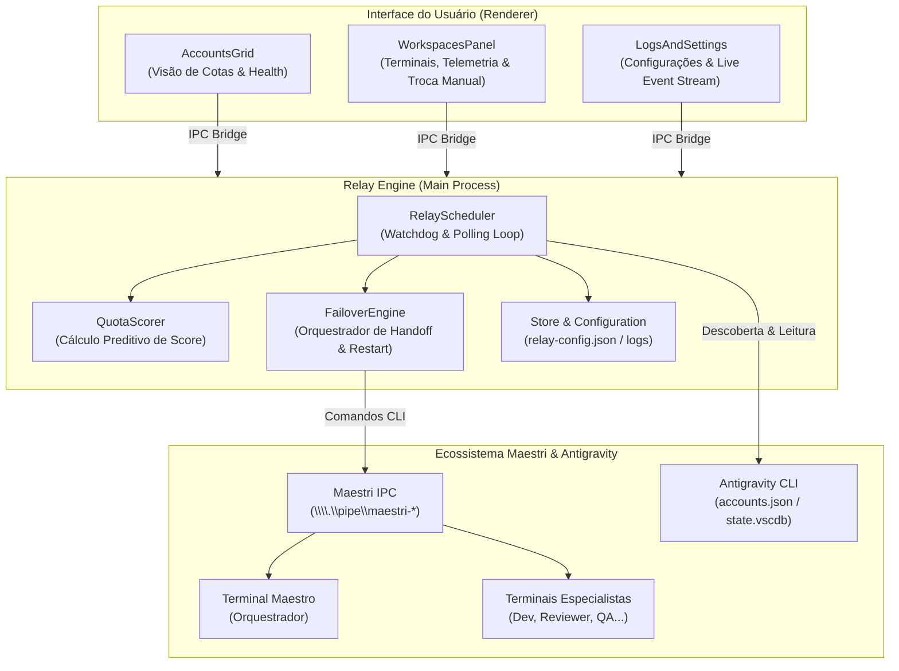

# Relay

<p align="center">
  
</p>

<p align="center">
  <strong>Multi-account quota broker and intelligent failover watchdog for Maestri & Antigravity.</strong>
</p>

<p align="center">
  <a href="https://github.com/saulobraine/relay/releases/tag/v0.1.0"></a>
  <a href="#"></a>
  <a href="https://www.electronjs.org/"></a>
  <a href="https://react.dev/"></a>
  <a href="https://www.typescriptlang.org/"></a>
  <a href="LICENSE"></a>
</p>

---

## 📌 Visão Geral: O Problema e a Solução

### O Problema
No ecossistema **Maestri** e **Antigravity CLI**, ambientes com múltiplos agentes especialistas geram intenso consumo concorrente de cotas dos modelos de linguagem (janela de 5 horas e limite semanal). 

Quando um especialista atinge o limite de requisições (**HTTP 429 Rate Limit**) ou entra em cooldown de cota, as tarefas sofrem estagnação imediata. A intervenção manual exige identificar qual conta foi bloqueada, selecionar uma conta alternativa no pool, reiniciar o terminal e reintroduzir o contexto perdido — gerando gargalos críticos no fluxo de orquestração.

### A Solução
O **Relay** opera em background como um **Quota Broker** e **Watchdog de Alta Disponibilidade** nativo para Windows:
- **Monitora continuamente** a saúde de cada conta cadastrada e os terminais ativos nos workspaces e andares do Maestri.
- **Calcula scores preditivos** considerando a saturação da janela de 5h, folga semanal e carga concorrente de terminais.
- **Orquestra failovers a quente**: ao detectar esgotamento ou erro 429, substitui automaticamente a credencial do agente e injeta contexto de handoff via CLI Bridge, preservando a continuidade do trabalho sem fricção.

---

## ✨ Recursos Principais

- ⚡ **Auto-Failover com Handoff & Context Injection**: Identifica terminais bloqueados e executa a troca automática para a conta com melhor score de prontidão, transmitindo o histórico de execução recente (`maestri recall`) para retomada instantânea.
- 🎯 **Algoritmo de Scoring de Cotas**: Avaliação multidimensional em tempo real de contas `READY`, `DRAINING`, `COOLDOWN_5H` e `EXHAUSTED_WEEKLY`, evitando concentrar terminais na mesma conta (`least-loaded` ou `score`).
- 🛡️ **Proteção e Blindagem do Maestro**:
  - `monitorOnlyMaestro`: Foco exclusivo das varreduras ativas no terminal Maestro, poupando overhead e mantendo trocas dos especialistas manuais.
  - `excludeMaestroFromPool`: Blinda a conta dedicada do orquestrador para que ela nunca seja consumida ou recrutada por especialistas durante trocas de emergência.
- 📊 **Telemetria Visual de Frota**: Interface escura construída com Tailwind e Geist Font, fornecendo visualização de latência de leitura, health badge em tempo real, inspeção de buffers de terminal e paginação de alta densidade.
- 📜 **Live Audit Stream**: Registro em tempo real de trocas, alertas e alterações de configuração com suporte a filtros por severidade e exportação em JSON.
- 🪟 **Integração Nativa com Windows**: Execução silenciosa na bandeja do sistema (System Tray), inicialização com o Windows e integração com Named Pipe do Maestri.

---

## 🏗️ Arquitetura do Sistema



---

## 📥 Downloads — Release v0.1.0

Acesse os instaladores oficiais para Windows x64:

| Versão | Formato | Arquivo | Download Direto | Hash SHA-256 |
| :--- | :--- | :--- | :--- | :--- |
| **v0.1.0** | **Portable** | `Relay-0.1.0-portable.exe` | [Baixar Executável](https://github.com/saulobraine/relay/releases/download/v0.1.0/Relay-0.1.0-portable.exe) | `B68DE4F7FCE7307A44336B73900C1FD9C50DC363412DEEB6A6EEDB3690FD6434` |
| **v0.1.0** | **Setup (NSIS)** | `Relay-Setup-0.1.0.exe` | [Baixar Instalador](https://github.com/saulobraine/relay/releases/download/v0.1.0/Relay-Setup-0.1.0.exe) | `26A4F046CE5E8368D8EC1461E0C419AC251F8E49D76FF1A8C3D312916C9F5AD6` |

Para validar a integridade dos binários no PowerShell:
```powershell
Get-FileHash -Algorithm SHA256 .\Relay-Setup-0.1.0.exe
```

---

## 💻 Guia de Execução Local

### Pré-requisitos
- **Node.js** >= 20.18.0
- **npm** >= 10.0.0
- **Windows 10/11** (com Maestri instalado)

### Instalação
```bash
# Clone o repositório
git clone https://github.com/saulobraine/relay.git
cd relay

# Instale as dependências
npm install
```

### Scripts Disponíveis

| Comando | Descrição |
| :--- | :--- |
| `npm run dev` | Inicia o Relay em modo de desenvolvimento com Hot Reload (Electron + Vite) |
| `npm run build` | Compila o código TypeScript do main, preload e renderer |
| `npm run typecheck` | Executa validação estática de tipos via `tsc --noEmit` |
| `npm test` | Roda a suite de testes unitários e de integração com Vitest |
| `npm run dist` | Empacota os binários de distribuição Windows (NSIS Installer e Portable) |
| `npm run pack` | Gera a pasta desempacotada `win-unpacked` para testes rápidos |

---

## ⚙️ Referência de Configurações (`relay-config.json`)

As preferências são persistidas no diretório de dados do usuário (`%APPDATA%\Relay\relay-config.json`):

| Propriedade | Tipo | Padrão | Descrição |
| :--- | :--- | :--- | :--- |
| `autoFailover` | `boolean` | `true` | Habilita a troca automática de conta em caso de bloqueio 429 ou esgotamento de quota. |
| `monitorOnlyMaestro` | `boolean` | `true` | Restringe a checagem ativa de saúde e o auto-failover exclusivamente ao terminal do Maestro. |
| `excludeMaestroFromPool` | `boolean` | `true` | Impede que a conta reservada ao Maestro seja recrutada para terminais especialistas. |
| `maestroDedicatedAccountId` | `string \| null` | `null` | ID da conta Antigravity prioritária reservada para uso pelo Maestro. |
| `autoRebalance` | `boolean` | `false` | Redistribui terminais ociosos quando contas `READY` com score superior ficarem disponíveis. |
| `onlyActiveWorkspace` | `boolean` | `false` | Limita o escopo de monitoramento ao workspace que estiver com foco no Maestri. |
| `fallbackRoutingPolicy` | `'score' \| 'least-loaded'` | `'score'` | Critério de desempate na escolha da conta substituta. |
| `min5hPercent` | `number` | `12` | Piso percentual crítico da janela de 5 horas para acionar troca preventiva. |
| `minWeeklyPercent` | `number` | `5` | Piso percentual mínimo semanal antes de considerar a conta em dreno/exaustão. |
| `quotaPollIntervalSeconds` | `number` | `180` | Intervalo em segundos para sincronização periódica de cotas em disco. |
| `terminalPollIntervalSeconds` | `number` | `25` | Intervalo em segundos para varredura de status dos terminais conectados. |
| `quotaTimeoutSeconds` | `number` | `20` | Timeout máximo para requisições ativas de cota via CLI. |
| `openAtLogin` | `boolean` | `true` | Inicializa o Relay minimizado automaticamente junto com o Windows. |
| `minimizeToTray` | `boolean` | `true` | Minimiza o aplicativo para a bandeja do sistema ao fechar a janela. |
| `excludedAccountIds` | `string[]` | `[]` | Lista de IDs de contas explicitamente ignoradas pelo algoritmo de failover. |

---

## 📄 Licença

Distribuído sob a licença **MIT**. Consulte o arquivo [LICENSE](LICENSE) para mais detalhes.
